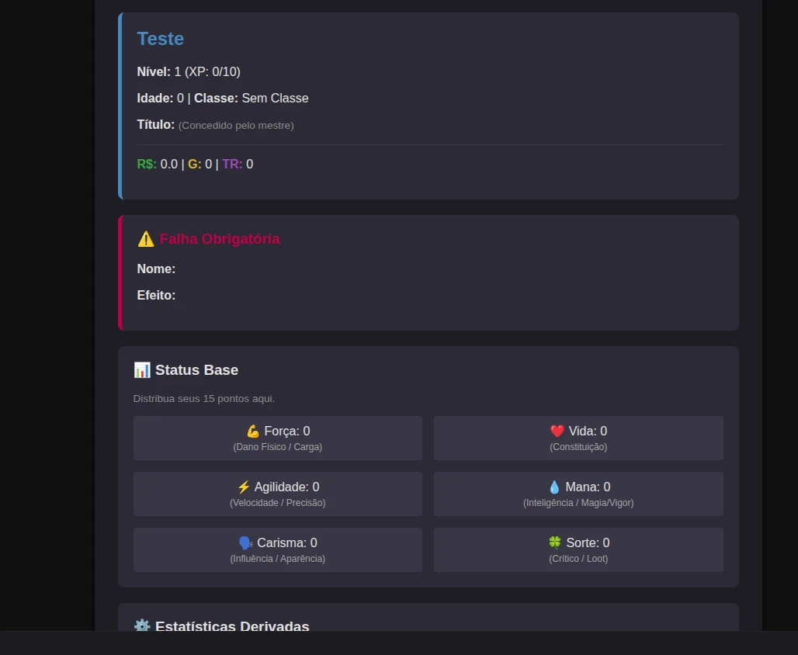
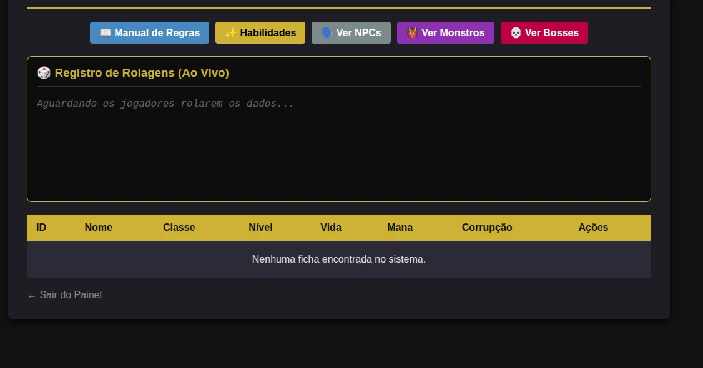
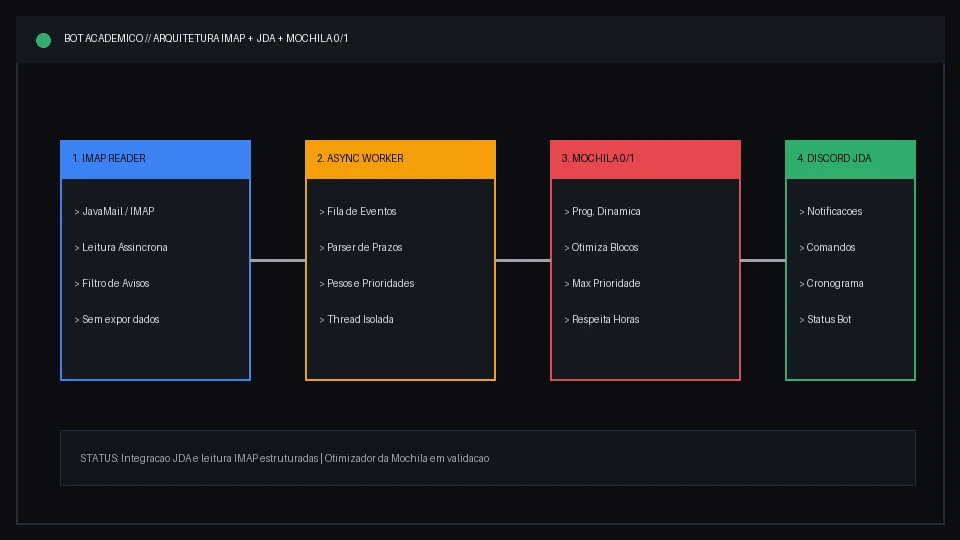
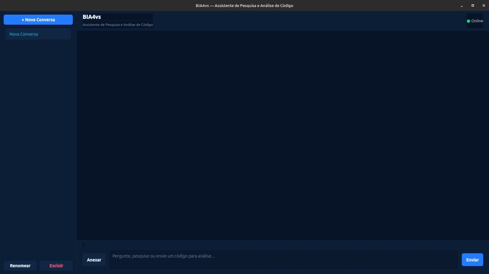
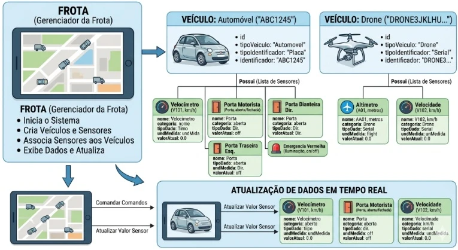
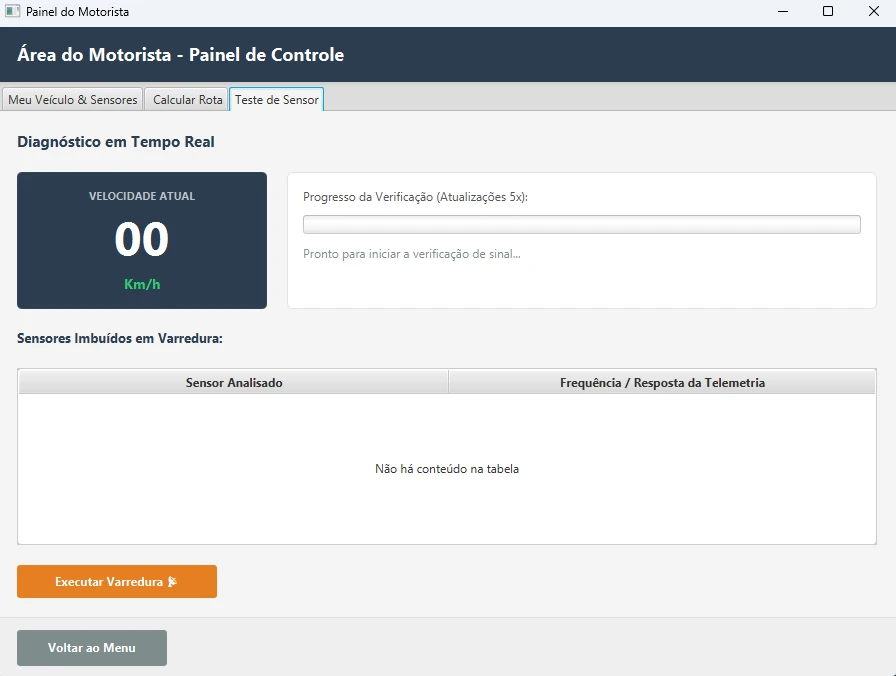

# Olá, eu sou o Victor Eduardo 👋

### Estudante de Engenharia da Computação (UFG) | Desenvolvimento Backend & Engenharia de Software

Em busca de **Estágio em Desenvolvimento de Software** (Backend / Full-Stack — Java, Spring Boot, SQL e Python).

---

## Sobre Mim

Graduando em **Engenharia da Computação na Universidade Federal de Goiás (UFG)**, com foco em **Desenvolvimento Backend**, **Arquitetura em Camadas**, **Modelagem Relacional** e **Automação**.

- Base técnica voltada para **Java (Spring Boot, Spring Security, JDBC, JavaFX, JDA, JUnit)**, **SQL (MySQL, PostgreSQL, SQLite, H2)** e **Python**, além de **Git/GitHub**, **Docker** e **Linux**.
- Experiência profissional prévia de **1 ano e 6 meses** como Jovem Aprendiz (Administrativo e TI, via CESAM) na Santa Casa de Misericórdia de Goiânia, atuando com suporte técnico cotidiano e organização de rotinas entre setores.
- Portfólio interativo com telas, decisões de arquitetura e currículo atualizado em **[victoreduardo-coder.github.io/portfolio](https://victoreduardo-coder.github.io/portfolio/)**.

---

## Projetos em Destaque

### [🎲 SystemRPG — Plataforma Web de Fichas e Regras](https://github.com/VictorEduardo-coder/SystemRPG)
Aplicação web e backend em **Java 21 + Spring Boot** para gerenciar fichas, inventário, motor econômico e rolagens ao vivo de um sistema autoral de RPG.
- **Destaques:** Arquitetura em camadas, autenticação com **Spring Security + BCrypt**, atualização em tempo real via **WebSockets**, persistência relacional em **MySQL / TiDB Cloud**, containerização com **Docker** e configuração de deploy para **Render**.
- **Stack:**     

  
  

### [🎓 Bot Acadêmico — Automação de Estudos no Discord](https://github.com/VictorEduardo-coder/bot-academico)
Bot em **Java (JDA)** integrado ao Discord e a caixas de e-mail via **IMAP** para organizar disciplinas, prazos e cronogramas de estudo.
- **Destaques:** Priorização heurística de blocos de estudo com `PriorityQueue`, leitura assíncrona de e-mails acadêmicos via **IMAP**, criptografia **AES-GCM** para credenciais, persistência em **H2** e API HTTP leve com **Javalin**.
- **Stack:**     

  

### [🤖 BIA4vs — Assistente Desktop de Pesquisa e Análise de Código](https://github.com/VictorEduardo-coder/BIA4vs)
Aplicação desktop modular em **Python (PyQt5)** voltada para apoio técnico, envio de múltiplos arquivos de código e gerenciamento local de histórico.
- **Destaques:** Interface escura em **PyQt5**, organização modular (`core`, `code_analysis`, `files`, `research`, `storage`), histórico persistido em **SQLite** e suporte a provedores externos ou **Ollama** local via variáveis de ambiente.
- **Stack:**   

  

### [🚗 Gestão de Frotas (JHC Telemetria) — Plataforma Desktop JavaFX & PostgreSQL](https://github.com/VictorEduardo-coder/Gestao-de-Frotas)
Aplicação desktop em **Java 17+ e JavaFX** com persistência em **PostgreSQL (JDBC)** para gerenciamento de veículos, vínculo de sensores de telemetria e controle de acesso por perfil (**RBAC**).
- **Destaques:** Modelagem OOP com herança, interface `Autenticavel`, `record` imutável para coordenadas GPS (`Localizacao`), camada DAO (`repository/`) parametrizada por variáveis de ambiente e painéis distintos por nível de acesso.
- **Stack:**   

  
  

### [🌐 Portfólio Interativo](https://github.com/VictorEduardo-coder/portfolio)
Vitrine técnica bilíngue (PT/EN) hospedada no **GitHub Pages**, reunindo projetos, decisões arquiteturais, laboratório interativo de algoritmos/APIs e testes automatizados em Node.js.
- **Stack:**    

---

## Tecnologias e Ferramentas

| Categoria | Tecnologias |
| :--- | :--- |
| **Linguagens** | Java, Python, SQL, C (C11), JavaScript |
| **Backend & Web** | Spring Boot, Spring Security, API REST, WebSockets, JDBC, JDA, Javalin, Thymeleaf |
| **Bancos de Dados** | MySQL, PostgreSQL, SQLite, H2 |
| **Ferramentas & Ambiente** | Git, GitHub, Linux, Maven, Docker, JUnit, PyQt5, JavaFX |

  
  
  
  
  
  
  
  
  
  

---

## Contato

- **Portfólio:** [victoreduardo-coder.github.io/portfolio](https://victoreduardo-coder.github.io/portfolio/)
- **LinkedIn:** [linkedin.com/in/victoreduardo-coder](https://www.linkedin.com/in/victoreduardo-coder/)
- **E-mail:** [victoreduardo.alm@gmail.com](mailto:victoreduardo.alm@gmail.com)
